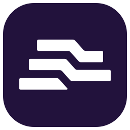
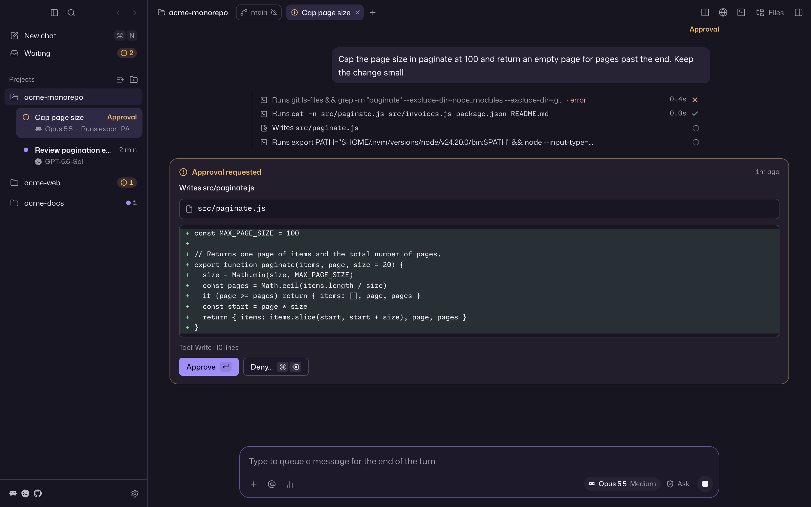

  

<h1 align="center">Ladder</h1>

Every agent, every repo, one calm window.

  <a href="https://itsladder.dev/download"><strong>Download for Mac</strong></a> ·
  <a href="https://itsladder.dev/docs">Docs</a> ·
  <a href="https://itsladder.dev/changelog">Changelog</a> ·
  <a href="https://itsladder.dev">Website</a>

Ladder is a macOS app for people who work on several repositories at once with coding agents. It puts every project and every agent session in one window: you see who is working, who is done and who is waiting for you, and you step in with a click instead of hunting through terminals and chat windows.

It works with Claude, Codex and any agent that speaks the [Agent Client Protocol](https://agentclientprotocol.com) (ACP), in a chat or in a terminal.

## Why it exists

I started Ladder for myself. Working on several projects at the same time, each with an agent running, I spent more time switching between windows than doing the work. Ladder is the workspace I wanted: one place that tells me where I'm needed and lets me answer from there.

It has been in development since November 7, 2026, and the first public release, v0.1.0, shipped on November 23, 2026. The commit history in this repository goes back to the first day.

## What it does

- **All your projects side by side.** Each session shows its state (running, waiting, unread, error), and one "Waiting" view collects the approvals and questions from every project.
- **Agents that don't collide.** A session can work in its own git worktree, so two agents on the same repository never touch the same files. A merge panel shows the branch, the PR, CI and review comments.
- **Agents that work together.** Hand a session off to another agent with a summary of what was done, ask one or more agents for a second opinion, or let an agent delegate part of the work.
- **Plans that run themselves.** Type `/plan` and a goal: the agent proposes a plan, you edit and approve it, and Ladder runs it task by task, each with the right agent, in dependency order.
- **Your subscriptions, your limits.** Agents use their own sign-in and your existing plans. Ladder shows how much of each plan limit is left and suggests another agent when one runs out.
- **Files, diffs and a terminal at hand.** Review changes per turn, comment on lines, open files and run commands without leaving the session.
- **No account, no telemetry.** Ladder talks to the network only for what you use, and stores no secrets apart from an optional Linear API key, encrypted in the Keychain.

The [full feature list](docs/FEATURES.md) covers everything in detail.

## Install

[Download Ladder](https://itsladder.dev/download) for Apple Silicon or Intel Macs. Builds are signed, notarized and update themselves.

You need at least one agent signed in on your Mac, for example the [Claude Code](https://claude.com/product/claude-code) CLI or [Codex](https://developers.openai.com/codex/cli). Ladder finds the ones you already have; if Codex, the `gh` CLI or an ACP agent is missing, it can download it after you confirm the version, size and checksum.

A phone app to follow sessions and approve requests away from your desk is in the works.

## Status

Early and moving fast. I use Ladder every day; expect rough edges and changes between versions. Feedback and bug reports are very welcome.

## Documentation

- [Getting started and usage](https://itsladder.dev/docs)
- [Full feature list](docs/FEATURES.md)
- [Project configuration](docs/CONFIGURATION.md) (`.ladder/settings.toml`: worktree setup, run buttons, agents, prompts)
- [Building from source and architecture](docs/DEVELOPMENT.md)
- [Privacy](https://itsladder.dev/privacy)

## A look at Ladder

  

## Contributing

Issues and pull requests are welcome. Ladder is maintained by one person, so please open an issue before a large change. See [CONTRIBUTING.md](CONTRIBUTING.md); for security issues, [SECURITY.md](SECURITY.md).

## License

Ladder is licensed under the [Apache License 2.0](LICENSE). See [NOTICE](NOTICE).

> Ladder is an independent project. It is not affiliated with or endorsed by Anthropic, OpenAI, Google or the makers of the other agents it works with. Product names belong to their respective owners.
